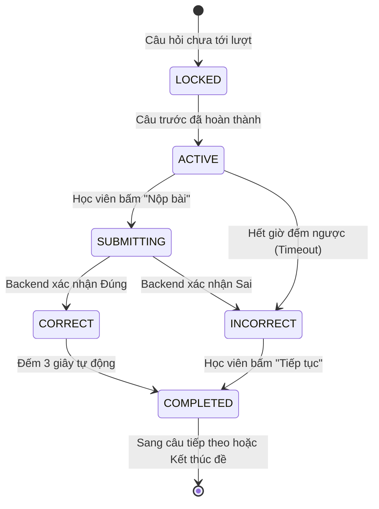

# Tài liệu Tổng quan Kỹ thuật & Lịch sử Phát triển Project CourseManagement
> **Nguồn gốc dữ liệu:** Được trích xuất, phân tích và tổng hợp từ toàn bộ lịch sử 31 phiên hội thoại (929 tin nhắn) giữa lập trình viên và AI Codex (lưu trong cơ sở dữ liệu SQLite tại `C:\Users\LENOVO\.codex`).

---

## MỤC LỤC
1. [Giới thiệu & Lịch sử Phát triển](#1-giới-thiệu--lịch-sử-phát-triển)
2. [Kiến trúc Tổng thể & Công nghệ Sử dụng](#2-kiến-trúc-tổng-thể--công-nghệ-sử-dụng)
3. [Phân tích Chi tiết Các Phân hệ Nghiệp vụ](#3-phân-tích-chi-tiết-các-phân-hệ-nghiệp-vụ)
   - 3.1. [Xác thực & Quản lý Người dùng (Authentication & RBAC)](#31-xác-thực--quản-lý-người-dùng-authentication--rbac)
   - 3.2. [Dịch vụ Xác minh Email (Email Verification Service)](#32-dịch-vụ-xác-minh-email-email-verification-service)
   - 3.3. [Ngân hàng Câu hỏi & Quản lý Đa phương tiện (Questions & Media Engine)](#33-ngân-hàng-câu-hỏi--quản-lý-đa-phương-tiện-questions--media-engine)
   - 3.4. [Hệ thống Thi Trực tuyến V2 (Sequential Exam Engine)](#34-hệ-thống-thi-trực-tuyến-v2-sequential-exam-engine)
4. [Kiểm toán An ninh & Gia cố Hệ thống (Codex Security Audit)](#4-kiểm-toán-an-ninh--gia-cố-hệ-thống-codex-security-audit)
5. [Quy hoạch Hạ tầng & Dự toán Chi phí Vận hành](#5-quy-hoạch-hạ-tầng--dự-toán-chi-phí-vận-hành)
6. [Cẩm nang Xử lý Sự cố & Kinh nghiệm Kiểm thử (Troubleshooting Dossier)](#6-cẩm-nang-xử-lý-sự-cố--kinh-nghiệm-kiểm-thử-troubleshooting-dossier)
7. [Mục lục Tra cứu Hội thoại Gốc (Chat Archive Index)](#7-mục-lục-tra-cứu-hội-thoại-gốc-chat-archive-index)

---

## 1. Giới thiệu & Lịch sử Phát triển

### 1.1. Mục tiêu Dự án
**CourseManagement** là nền tảng quản lý khóa học, tài liệu học tập và tổ chức thi trắc nghiệm trực tuyến toàn diện, bao gồm 2 repository chính:
- **Backend:** `CourseManagement` (NestJS 10, TypeScript, Prisma ORM, PostgreSQL).
- **Frontend:** `CourseManagement_fe` (React, Vite, Tailwind CSS, Axios).

Hệ thống cung cấp trải nghiệm học tập và thi cử hiện đại, tập trung vào:
- Quản lý học viên, giảng viên và quản trị viên (RBAC).
- Quản lý môn học, tài liệu đa phương tiện (PDF, DOCX, Video nhúng).
- Ngân hàng câu hỏi trắc nghiệm và tổ chức đề thi.
- Cơ chế làm bài thi tuần tự có tính giờ từng câu, chấm điểm chống gian lận và phản hồi tức thì.

### 1.2. Dòng thời gian phát triển (Timeline & Milestones)
Dựa trên 31 phiên hội thoại với Codex từ tháng 07/2026 đến tháng 10/2026:

| Mốc thời gian | Sự kiện & Quyết định Kỹ thuật chính | Hội thoại liên quan |
|---|---|---|
| **15/07/2026** | Khởi tạo dự án, lập kế hoạch kiến trúc tổng thể cho nền tảng website | `019f65e3`, `019f65e4` |
| **11/08/2026** | Cấu hình Prisma ORM, giải quyết xung đột typing `$queryRaw` trên `PrismaService` | `019ff0af` |
| **17/08/2026** | Phân tích và cấu trúc lại toàn bộ các module trong repository | `01a00dda` |
| **23/08/2026** | Xử lý cấu hình biến môi trường `JWT_SECRET` cho NestJS Auth module | `01a02f7b` |
| **24/08/2026** | Hoàn thiện module Questions: CRUD câu hỏi theo đề thi, bulk create, validation | `01a03413`, `01a03415`, `01a03489`, `01a034a8` |
| **25/08/2026** | Thiết kế lại giao diện Frontend theo gợi ý Figma (Walkthrough & Theme proposals) | `01a038dc` |
| **26/08/2026** | Rà soát toàn diện hệ thống: Tích hợp Google Cloud Storage (GCS) cho file media, sửa lỗi Admin tự khóa chính mình | `01a03cbb` |
| **27/08/2026** | Thiết lập Service Account GCS (`course-media-uploader.json`), cân nhắc migrate Cloud SQL sang Neon | `01a04298`, `01a04390`, `01a0440b` |
| **28/08/2026** | Deploy lên Render (Backend) và Vercel (Frontend); xử lý lỗi CORS, upload file DOCX, lỗi YouTube Video Error 153 | `01a046eb`, `01a04709`, `01a0470e` |
| **02/09/2026** | Kiểm thử chuyên sâu (Senior Tester role), sửa giao diện responsive trên iPad/Tablet, bổ sung tính năng Admin đổi mật khẩu học viên | `01a05f70`, `01a0626a`, `01a0628e` |
| **05/09/2026** | Xử lý sự cố đồng bộ dữ liệu Cloud SQL sau khi reset DB (`seed.ts`), sửa logic tài khoản Free giới hạn 2 đề thi | `01a07180`, `01a0723b` |
| **06/09/2026** | Xây dựng tính năng xác minh Email (Email Verification): Chuyển từ Resend sang Gmail API, chống spam token, sửa lỗi 503 | `01a07459` |
| **11/09/2026** | Cải tổ triệt để hệ thống thi cử: Chuyển từ luồng tự do V1 sang **Hệ thống thi tuần tự Exam V2**; bỏ cơ chế lưu tạm và đánh dấu xem lại; lập bảng dự toán hạ tầng | `01a08dfe`, `01a08e55`, `01a08f63`, `01a08f6e` |
| **27/09/2026** | Thực hiện kiểm toán an ninh với **Codex Security**: Vá các lỗ hổng High/Medium/Low, tạo PR #3 (BE) và PR #2 (FE), loại bỏ `prismaorm.dump`, bật TLS verification | `01a0e3ad` |
| **14/10/2026** | Trích xuất và số hóa toàn bộ lịch sử trao đổi thành bộ tài liệu chính thức | `01a1385e`, `01a13863` |

---

## 2. Kiến trúc Tổng thể & Công nghệ Sử dụng

### 2.1. Sơ đồ Kiến trúc Hệ thống

```
+-------------------------------------------------------------------------+
|                              CLIENT TIER                                |
|   CourseManagement_FE (React, Vite, Tailwind CSS) Hosted on VERCEL      |
+-------------------------------------------------------------------------+
                                     |
                                     | HTTPS / REST APIs
                                     v
+-------------------------------------------------------------------------+
|                            APPLICATION TIER                             |
|        CourseManagement Backend (NestJS 10) Hosted on RENDER            |
|                                                                         |
|  +-------------------+  +-------------------+  +---------------------+  |
|  |    Auth Module    |  |   Exams Module    |  |  Questions Module   |  |
|  |  (JWT, Mailer)    |  |  (V2 State Engine)|  |  (Media Validator)  |  |
|  +-------------------+  +-------------------+  +---------------------+  |
|  +-------------------+  +-------------------+  +---------------------+  |
|  |   Users Module    |  |  Subjects Module  |  |  Materials Module   |  |
|  |   (RBAC Guard)    |  |                   |  |  (DOCX/PDF/Video)   |  |
|  +-------------------+  +-------------------+  +---------------------+  |
|                                |                                        |
|                          Prisma ORM (v6/v7)                             |
+--------------------------------+----------------------------------------+
                                 |
        +------------------------+------------------------+
        | (TLS / SSL Enforced)                            | (Google Cloud SDK)
        v                                                 v
+----------------------------------+    +----------------------------------+
|           DATA TIER              |    |           OBJECT STORAGE         |
|   Google Cloud SQL (PostgreSQL)  |    |     Google Cloud Storage (GCS)   |
|  Local: Docker Compose (5432)    |    |     Bucket: course-media-bucket  |
+----------------------------------+    +----------------------------------+
```

### 2.2. Tech Stack Chi tiết

#### Backend (`CourseManagement`)
- **Framework:** NestJS 10 (Node.js runtime v20+).
- **Ngôn ngữ:** TypeScript 5.x.
- **ORM:** Prisma Client với PostgreSQL adapter.
- **Bảo mật & Xác thực:** Passport JWT, Bcrypt, Class-validator, Class-transformer.
- **Lưu trữ file:** `@google-cloud/storage`, Multer disk/memory storage.
- **Email:** Nodemailer (Gmail SMTP service) kèm cơ chế giới hạn tần suất (Rate limiting).
- **Môi trường & Container:** Docker Compose, Node.js scripts, Cloud SQL Proxy.

#### Frontend (`CourseManagement_fe`)
- **Framework:** React 18+ với Vite bundler.
- **UI Framework & Styling:** Tailwind CSS, Lucide React, Shadcn/Radix components.
- **HTTP Client:** Axios (cấu hình interceptor quản lý Bearer token & refresh state).
- **Routing:** React Router v6 với declarative routes và role-based route guards.

---

## 3. Phân tích Chi tiết Các Phân hệ Nghiệp vụ

### 3.1. Xác thực & Quản lý Người dùng (Authentication & RBAC)

#### A. Luồng Đăng ký & Kích hoạt Mật khẩu Bảo mật (V1 vs V2)
Trước phiên kiểm toán an ninh, người dùng đăng ký tài khoản đã phải cung cấp mật khẩu ngay lập tức. Điều này tạo ra rủi ro: kẻ tấn công có thể đăng ký bằng email của người khác và gán mật khẩu trước khi chủ sở hữu email kích hoạt tài khoản.

**Luồng mới (V2 An toàn):**
1. Người dùng gửi thông tin cơ bản: `fullName`, `email`, `dateOfBirth` (không gửi `password`).
2. Backend tạo tài khoản với `password = null`, tạo một `verificationToken` có thời hạn và gửi qua email.
3. Người dùng nhấp vào liên kết trong email: `https://.../verify-email?token=...`.
4. Màn hình xác thực yêu cầu người dùng thiết lập mật khẩu lần đầu.
5. Backend xác thực token, lưu mật khẩu đã băm (hash bằng bcrypt) và kích hoạt trạng thái tài khoản.

#### B. Phân quyền Người dùng (RBAC)
- 3 vai trò chính: `ADMIN`, `TEACHER`, `STUDENT`.
- **Quy tắc bảo vệ Admin:** Trong phiên họp `01a03cbb`, hệ thống bổ sung guard ngăn chặn Admin tự khóa chính mình hoặc tự giáng cấp vai trò của bản thân, tránh tình huống hệ thống mất hoàn toàn tài khoản quản trị.
- **Admin Reset Mật khẩu Học viên:** Do mật khẩu được băm một chiều, Admin không thể xem mật khẩu của học viên. Hệ thống cung cấp API cho phép Admin chủ động đặt lại mật khẩu mới cho học viên theo yêu cầu (`01a0628e`).
- **Chính sách Tài khoản Miễn phí (Free Tier):** Học viên tài khoản Free chỉ được phép truy cập tối đa 2 đề thi công khai (`published`). Hệ thống được tinh chỉnh để loại bỏ các phân công bài thi đã bị xóa mềm (`deletedAt IS NOT NULL`) khi tính toán giới hạn 2 đề này (`01a0723b`).

---

### 3.2. Dịch vụ Xác minh Email (Email Verification Service)

Trong quá trình phát triển (phiên `01a07459`), đội ngũ đã thử nghiệm Resend API nhưng gặp các trở ngại:
- Lỗi 422: Cần tên miền định danh đã được xác thực DKIM/SPF (`Invalid from address`).
- Lỗi 403: Chế độ sandbox của Resend chỉ cho phép gửi về chính email chủ sở hữu tài khoản đăng ký Resend.
- Quyết định: Chuyển sang sử dụng **Gmail SMTP / Nodemailer** với App Password cho môi trường staging/production nhằm tối ưu chi phí và tăng tỷ lệ vào hộp thư đến.
- Bổ sung cơ chế Rate-limit gửi lại email (Resend Cooldown): Ngăn chặn học viên click liên tục gây nghẽn hàng đợi hoặc bị Google khóa tạm thời.

---

### 3.3. Ngân hàng Câu hỏi & Quản lý Đa phương tiện (Questions & Media Engine)

#### A. Tách biệt Cấu trúc Môn học & Đề thi
Ban đầu, schema yêu cầu mọi đề thi (`Exam`) đều phải gắn với một `Subject`. Sau khi phân tích nghiệp vụ, mối quan hệ được tối ưu: đề thi có thể là bài kiểm tra tổng hợp hoặc thi thử liên môn, do đó chỉ có từng câu hỏi (`Question`) mới bắt buộc thuộc về một `Subject` cụ thể (`01a03cbb`).

#### B. Lưu trữ Đa phương tiện trên Google Cloud Storage (GCS)
- File media đính kèm trong câu hỏi (hình ảnh minh họa, sơ đồ) được upload trực tiếp lên bucket `gs://course-media-bucket`.
- Cấu hình xác thực thông qua Service Account Key `course-media-uploader.json`.
- Hỗ trợ xem trước và kiểm tra dung lượng định kỳ qua Cloud SDK.

#### C. Xử lý Video nhúng & Khắc phục Lỗi 153
- Học viên và giảng viên thường dán link YouTube dạng `https://www.youtube.com/watch?v=XXXXX`.
- Trình duyệt nhúng iframe link này sẽ bị lỗi chặn phát (Error 153 / Video player configuration error).
- Backend được bổ sung middleware/transformer tự động chuẩn hóa mọi link YouTube thành định dạng nhúng hợp lệ: `https://www.youtube.com/embed/XXXXX`.

---

### 3.4. Hệ thống Thi Trực tuyến V2 (Sequential Exam Engine)

Đây là phân hệ cốt lõi nhận được sự cải tổ toàn diện nhất (phiên `01a08dfe` và `01a08f6e`).

#### A. So sánh Luồng Thi Cũ (V1) vs Luồng Thi Mới (V2)

| Tiêu chí so sánh | Luồng Thi V1 (Cũ) | Luồng Thi V2 (Chuẩn hóa) |
|---|---|---|
| **Quyền kiểm soát thời gian** | Trình duyệt Client đếm ngược; dễ bị sửa code để gian lận. | **Server-authoritative:** Server ghi nhận `deadline` chính xác của từng câu qua `/session`. |
| **Thứ tự làm bài** | Tự do chuyển câu, nhảy cóc, quay lại câu cũ. | **Tuần tự nghiêm ngặt:** Làm xong câu N mới mở khóa câu N+1; không được quay lại. |
| **Nút bấm giao diện** | 3 nút gây bối rối (`Lưu tạm`, `Nộp câu hiện tại`, `Nộp bài`). | **1 nút bấm duy nhất:** Luân chuyển trạng thái `Nộp bài` -> `Tiếp tục`. |
| **Phản hồi câu trả lời đúng** | Không rõ ràng, phải tự bấm tiếp. | **Tự động chuyển câu sau 3 giây:** Khóa chỉnh sửa, hiển thị trạng thái đúng, tự động sang câu tiếp theo. |
| **Phản hồi câu trả lời sai** | Không có hướng dẫn trực quan ngay lập tức. | **Hiển thị Đáp án Đúng + Hướng dẫn + Giải thích:** Nút bấm đổi thành `Tiếp tục` để học viên chủ động đọc hiểu. |
| **Lưu tạm & Đánh dấu xem lại** | Phức tạp, dễ xung đột trạng thái khi refresh. | **Đã loại bỏ:** Đảm bảo luồng làm bài tập trung, dứt khoát và kết quả xác thực. |
| **Ngôn ngữ hiển thị** | Tiếng Anh pha lẫn tiếng Việt (`Submit`, `Continue`). | **Việt hóa 100%:** `Nộp bài`, `Đang nộp...`, `Tiếp tục`, `Hướng dẫn`, `Giải thích`. |

#### B. Máy Trạng thái Câu hỏi & Nút bấm (State Machine)



---

## 4. Kiểm toán An ninh & Gia cố Hệ thống (Codex Security Audit)

Trong phiên `01a0e3ad` (ngày 27/09/2026), dự án đã trải qua đợt đánh giá an ninh chuyên sâu bởi Codex Security. Các phát hiện và biện pháp khắc phục đã được đóng gói thành **PR #3 (Backend)** và **PR #2 (Frontend)**:

### 4.1. Các Lỗ hổng Mức độ Cao & Nghiêm trọng (High / Critical)
1. **Lộ file dữ liệu sao lưu `prismaorm.dump`:**
   - *Nguy cơ:* File dump PostgreSQL nằm trong source code chứa 11 tài khoản người dùng, 6 đề thi, 34 câu hỏi và 39 lượt làm bài.
   - *Khắc phục:* Xóa bỏ file khỏi cây thư mục làm việc trong PR #3; khuyến nghị nhóm kỹ thuật chạy công cụ xóa lịch sử Git (`git filter-repo`) trước khi công khai kho lưu trữ.
2. **PostgreSQL TLS/SSL Không Xác minh Chứng chỉ:**
   - *Nguy cơ:* Ứng dụng production mã hóa kênh truyền nhưng không kiểm tra chứng chỉ máy chủ (chấp nhận self-signed), tiềm ẩn rủi ro tấn công Man-In-The-Middle (MITM).
   - *Khắc phục:* Bật chế độ `sslmode=require` và kiểm tra chứng chỉ đầy đủ, hỗ trợ cấu hình chứng chỉ qua biến môi trường `DATABASE_SSL_CA`.

### 4.2. Các Lỗ hổng Mức độ Trung bình (Medium)
1. **Gian lận Điểm thi ở Client:**
   - *Nguy cơ:* Luồng cũ cho phép client gửi kèm `normalizedText` và `numericValue` lên server khi nộp bài.
   - *Khắc phục:* Server từ chối mọi dữ liệu chuẩn hóa từ client; backend tự truy vấn database, tự so sánh và tự tính điểm độc lập.
2. **Kích hoạt Mật khẩu Trước khi Xác minh Email:**
   - *Khắc phục:* Chuyển sang luồng tạo mật khẩu sau khi xác minh link email. Thêm migration xóa các mật khẩu rác của tài khoản chưa xác minh.
3. **Cơ chế Thu hồi Phiên JWT:**
   - *Khắc phục:* Bổ sung kiểm tra trạng thái tài khoản vào JWT Strategy. Khi tài khoản bị khóa hoặc đổi vai trò, các token cũ lập tức bị từ chối truy cập.

### 4.3. Các Cải tiến Cấu hình Triển khai (DevOps Hardening)
- Cập nhật `docker-compose.yml`: Bỏ mật khẩu mặc định `postgrespassword`. Yêu cầu khai báo biến môi trường `POSTGRES_PASSWORD` trong file `.env`.
- Ràng buộc cổng cơ sở dữ liệu: Giới hạn cổng PostgreSQL `5432` và Adminer `8080` chỉ lắng nghe trên `127.0.0.1` (localhost), ngăn chặn truy cập trái phép từ bên ngoài mạng nội bộ.

---

## 5. Quy hoạch Hạ tầng & Dự toán Chi phí Vận hành

Tại phiên `01a08e55`, một bảng tính chi tiết đã được xây dựng để so sánh các lựa chọn hạ tầng cho CourseManagement:
> *File bảng tính chi tiết đính kèm:* [`outputs/01a08e55-f8f9-7561-992c-cfa8a11e395c/infrastructure_design_cost_plan.xlsx`](file:///d:/Project/CourseManagement/outputs/01a08e55-f8f9-7561-992c-cfa8a11e395c/infrastructure_design_cost_plan.xlsx)

### 5.1. Bảng So sánh Hạ tầng Kỹ thuật

| Thành phần | Lựa chọn Đề xuất | Phương án Thay thế | Lý do & Ưu thế |
|---|---|---|---|
| **Database** | **Supabase / Neon Postgres** | GCP Cloud SQL | Tiết kiệm chi phí ban đầu (Cloud SQL tối thiểu ~$30-$40/tháng, trong khi Supabase/Neon có gói miễn phí và nâng cấp linh hoạt). |
| **Compute / API** | **Render / Amazon EC2 (`t4g.small`)** | Cloud Run | EC2 tại khu vực Đông Nam Á (Bangkok / Singapore) cho độ trễ cực thấp (<30ms về Việt Nam). |
| **Media Storage** | **Google Cloud Storage (GCS)** | AWS S3 / Cloudflare R2 | Đã có sẵn integration qua Service Account trong backend, dung lượng mở rộng tự động. |
| **Email Service** | **Resend (Transact) + Google Workspace** | Gmail SMTP cá nhân | Gmail cá nhân chỉ dùng cho dev/staging (giới hạn 500 mail/ngày). Production cần dùng Resend để đảm bảo deliverability. |
| **Tên miền** | **Domain `.com`** (Namecheap/Cloudflare) | - | Chuẩn hóa thương hiệu, chi phí cố định ~$10 - $14/năm. |

### 5.2. Các Kịch bản Chi phí Hàng tháng (Ước tính)

```
+------------------------------------------------------------------------------------+
| KỊCH BẢN CHI PHÍ HÀNG THÁNG (USD)                                                  |
+------------------------------------------------------------------------------------+
| 1. Giai đoạn MVP / Thử nghiệm:                     ~ $0.87 / tháng                |
|    - Vercel Free + Render Free + Supabase Free + Gmail SMTP                        |
+------------------------------------------------------------------------------------+
| 2. Production Tiêu chuẩn (Khuyên dùng):            ~ $45.86 / tháng               |
|    - 1 EC2 t4g.small (Bangkok) + 30GB EBS gp3:      $15.00                        |
|    - 1 Supabase Pro Database (High Availability):    $25.00                        |
|    - Domain .com (phân bổ hàng tháng):               $1.00                         |
|    - Email Resend (Free Tier < 3.000 mail/tháng):    $0.00                         |
|    - GCS Storage & Egress:                           $4.86                         |
+------------------------------------------------------------------------------------+
| 3. Production Doanh nghiệp (Google Workspace):     ~ $52.86 / tháng               |
|    - Kịch bản 2 + Hộp thư Google Workspace riêng:    +$7.00/user                   |
+------------------------------------------------------------------------------------+
| 4. Production Quy mô lớn (Resend Pro):             ~ $65.86 / tháng               |
|    - Kịch bản 2 + Gói Resend Pro (50.000 email):     +$20.00                       |
+------------------------------------------------------------------------------------+
```

---

## 6. Cẩm nang Xử lý Sự cố & Kinh nghiệm Kiểm thử (Troubleshooting Dossier)

Tổng hợp các vấn đề kỹ thuật thực tế đã gặp và cách xử lý triệt để trong dự án:

### 6.1. Sự cố Lỗi Type `$queryRaw` trên `PrismaService`
- **Hiện tượng:** TypeScript báo lỗi `Property '$queryRaw' does not exist on type 'PrismaService'.ts(2339)`.
- **Nguyên nhân:** Khi kế thừa `PrismaClient` trong NestJS, nếu generator client chưa được chạy lại sau khi sửa `schema.prisma` hoặc cấu hình `prisma.config.ts`, TypeScript sẽ sử dụng kiểu dữ liệu cũ trong `node_modules`.
- **Khắc phục:** Chạy lệnh `pnpm exec prisma generate` và đảm bảo export đúng class `PrismaService extends PrismaClient implements OnModuleInit`.

### 6.2. Lỗi CORS khi gọi API giữa Vercel và Render
- **Hiện tượng:** `Access to XMLHttpRequest at '...' from origin 'https://...vercel.app' has been blocked by CORS policy`.
- **Khắc phục:** Trong `main.ts` của NestJS, cấu hình whitelist nguồn gốc đầy đủ:
  ```typescript
  app.enableCors({
    origin: [
      'http://localhost:5173',
      'https://course-management-fe-one.vercel.app',
      /\.vercel\.app$/
    ],
    credentials: true,
    methods: ['GET', 'POST', 'PUT', 'PATCH', 'DELETE', 'OPTIONS']
  });
  ```

### 6.3. Lỗi 404 khi Tải lại trang (Reload) trên Vercel
- **Hiện tượng:** Truy cập trực tiếp link con (ví dụ: `/login`, `/exams`) hoặc bấm F5 thì Vercel trả về mã lỗi 404.
- **Nguyên nhân:** Ứng dụng Single Page Application (SPA) cần máy chủ điều hướng mọi route về `index.html`.
- **Khắc phục:** Thêm file `vercel.json` tại thư mục gốc của frontend:
  ```json
  {
    "rewrites": [
      { "source": "/(.*)", "destination": "/index.html" }
    ]
  }
  ```

### 6.4. Sự cố Database Reset & Foreign Key Error (`seed.ts`)
- **Hiện tượng:** Sau khi xóa bảng và chạy lại seed, hệ thống bị lỗi khóa ngoại khi cố gắng tạo câu trả lời cho đề thi chưa tồn tại.
- **Khắc phục:** Cấu hình thứ tự seed tuần tự theo mức độ phụ thuộc: `Users` -> `Subjects` -> `Materials` -> `Questions` -> `Exams` -> `ExamQuestions` -> `Assignments`.

### 6.5. Kiểm thử các trường hợp biên của Kỳ thi (Edge Cases)
Được xác lập bởi đội ngũ kiểm thử (phiên `01a05f70` và `01a08dfe`):
1. **Học viên tải lại trang (F5):** Client gọi `/session` để lấy lại câu hỏi hiện tại và thời gian còn lại (server-calculated). Không reset lại đồng hồ.
2. **Mất kết nối mạng tạm thời:** Nút nộp bài tự động retry hoặc giữ nguyên trạng thái đang nộp; không cho phép submit trùng lặp (Idempotency Key).
3. **Mở nhiều tab cùng lúc:** Chỉ tab gửi request hợp lệ sớm nhất được ghi nhận; các tab khác nhận thông báo trạng thái câu hỏi đã thay đổi và đồng bộ lại.
4. **Hết giờ đúng lúc bấm nộp:** Server ưu tiên thời điểm request đến; nếu quá thời hạn cho phép (kèm độ trễ mạng chấp nhận được ~2s), câu hỏi tự động bị coi là hết giờ và chấm điểm sai.

---

## 7. Mục lục Tra cứu Hội thoại Gốc (Chat Archive Index)

Toàn bộ 31 cuộc hội thoại đã được trích xuất nguyên vẹn ra các file markdown độc lập tại thư mục [`docs/codex-history/`](file:///d:/Project/CourseManagement/docs/codex-history/INDEX.md).

Dưới đây là liên kết nhanh đến một số cuộc hội thoại quan trọng nhất:
- [Hội thoại #11: Kiểm tra toàn diện hệ thống & Cloud Storage](file:///d:/Project/CourseManagement/docs/codex-history/thread_11_kim-tra.md)
- [Hội thoại #18: Kịch bản Kiểm thử Chuyên sâu cùng Senior Tester](file:///d:/Project/CourseManagement/docs/codex-history/thread_18_role-bn-l-mt-tester-vi-nhiu-nm-kinh-nghim-context-hi.md)
- [Hội thoại #23: Tích hợp Tính năng Xác thực Email](file:///d:/Project/CourseManagement/docs/codex-history/thread_23_hin-ti-cha-c-tnh-nng-xc-thc-email-gi-email-xc-nhn-x.md)
- [Hội thoại #25: Đặc tả Kiến trúc Hệ thống Thi Tuần tự V2](file:///d:/Project/CourseManagement/docs/codex-history/thread_25_markdown-role-you-are-a-senior-software-enginee.md)
- [Hội thoại #26: Bảng Dự toán Chi phí & Thiết kế Hạ tầng](file:///d:/Project/CourseManagement/docs/codex-history/thread_26_to-mt-sheet-lp-plan-thit-k-h-tng-vi-cc-chun-v-cc-mc.md)
- [Hội thoại #28: Tối giản UI Thi cử & Việt hóa Toàn diện](file:///d:/Project/CourseManagement/docs/codex-history/thread_28_b-c-ch-lu-tm.md)
- [Hội thoại #29: Báo cáo Kiểm toán An ninh Codex Security](file:///d:/Project/CourseManagement/docs/codex-history/thread_29_codex-securityplugin-codex-securityopenai-curate.md)

---
*Tài liệu được tổng hợp tự động bởi Antigravity Agent từ cơ sở dữ liệu SQLite Codex ngày 14/10/2026.*
