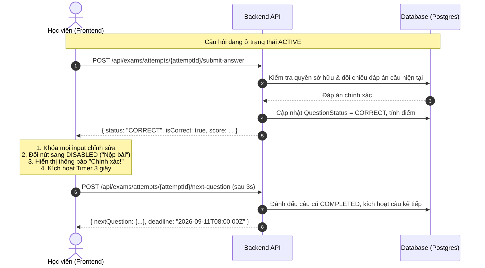
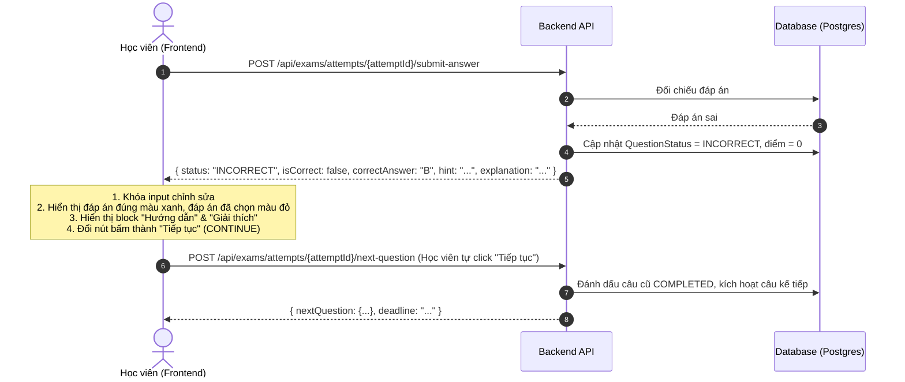

# Đặc tả Kỹ thuật Hệ thống Thi Tuần tự V2 (Exam V2 Specification)
> **Dự án:** CourseManagement (Backend & Frontend)  
> **Nguồn gốc:** Phê duyệt từ cuộc hội thoại thiết kế kiến trúc `#25` (`01a08dfe`) và tối ưu giao diện `#28` (`01a08f6e`).

---

## 1. Bối cảnh & Mục tiêu Chuyển đổi

### 1.1. Vấn đề của Luồng Thi Cũ (V1)
- **Kiểm soát thời gian lỏng lẻo:** Thời gian đếm ngược phụ thuộc vào đồng hồ máy tính của học viên (Client-side timer). Học viên có thể can thiệp bằng cách chỉnh giờ hệ điều hành hoặc sửa biến JavaScript để kéo dài thời gian làm bài.
- **Gian lận khi nộp bài:** Client tự tính toán và gửi kèm các trường `normalizedText` và `numericValue` lên server; server tin tưởng dữ liệu client thay vì tự tra cứu đáp án chuẩn từ cơ sở dữ liệu.
- **Rối loạn thao tác làm bài:** Màn hình thi hiển thị cùng lúc 3 nút bấm với chức năng chồng chéo: `Lưu tạm`, `Nộp câu hiện tại`, `Nộp bài thi`. Học viên có thể nhảy cóc giữa các câu mà chưa hoàn thành câu hiện tại.

### 1.2. Mục tiêu của Luồng Thi Tuần tự (V2)
1. **Server-Authoritative:** Server là nguồn chân lý duy nhất (Single Source of Truth) quyết định:
   - Học viên đang ở câu hỏi nào.
   - Thời hạn chính xác (`deadline`) cho câu hỏi đó.
   - Kết quả chấm điểm đúng/sai.
2. **Tuần tự Nghiêm ngặt (Strict Sequential):** Học viên phải hoàn thành câu hỏi theo đúng thứ tự:
   $$\text{Câu 1} \longrightarrow \text{Câu 2} \longrightarrow \text{Câu 3} \longrightarrow \dots \longrightarrow \text{Câu N}$$
   Không được phép nhảy cóc, không được quay lại câu đã làm.
3. **Trải nghiệm Tối giản (Single Action Button):** Chỉ có một nút duy nhất luân chuyển trạng thái: `Nộp bài` $\rightarrow$ `Đang nộp...` $\rightarrow$ `Tiếp tục`.
4. **Phản hồi Tức thì & Tự động:**
   - Khi trả lời **Đúng**: Tự động chuyển sang câu tiếp theo sau **3 giây** (không bắt học viên phải click thêm).
   - Khi trả lời **Sai**: Dừng lại, hiển thị Đáp án Đúng kèm Hướng dẫn & Giải thích chi tiết; nút bấm đổi thành `Tiếp tục` để học viên chủ động bấm khi đã đọc xong.

---

## 2. Máy Trạng thái (State Machine)

### 2.1. Trạng thái Câu hỏi (Question State)

```
        +---------------+
        |    LOCKED     |  (Câu chưa mở, chỉ xem được số thứ tự)
        +---------------+
                |
                | (Khi câu trước hoàn thành)
                v
        +---------------+
        |    ACTIVE     |  (Đang làm bài, đồng hồ đếm ngược chạy)
        +---------------+
                |
                +-------------------+
                | (Bấm Nộp bài)     | (Hết giờ đếm ngược)
                v                   v
        +---------------+   +---------------+
        |  SUBMITTING   |   |   TIMEOUT     |
        +---------------+   +---------------+
          |           |             |
   (Đúng) |    (Sai)  +-------------+
          v           v
    +---------+   +-----------+
    | CORRECT |   | INCORRECT |
    +---------+   +-----------+
          |           |
(Chờ 3s)  |           | (Bấm "Tiếp tục")
          v           v
        +---------------+
        |   COMPLETED   |  (Câu đã xong, khóa vĩnh viễn)
        +---------------+
```

### 2.2. Trạng thái Nút Bấm (Button State)

| Trạng thái Nút | Label Hiển thị | Trạng thái Tương tác | Ý nghĩa & Điều kiện Kích hoạt |
|---|---|---|---|
| `SUBMIT` | **Nộp bài** | Cho phép Click | Học viên đã chọn đáp án hoặc nhập nội dung, câu hỏi đang ở trạng thái `ACTIVE`. |
| `SUBMITTING` | **Đang nộp...** | Disable | Request đang được gửi lên Backend, chống double-click. |
| `CONTINUE` | **Tiếp tục** | Cho phép Click | Hiển thị khi câu trả lời **Sai** hoặc **Hết giờ**, cho phép học viên đọc giải thích rồi sang câu tiếp theo. |
| `DISABLED` | **Nộp bài** | Disable | Khi học viên trả lời **Đúng** (đang đếm ngược 3 giây) hoặc chưa chọn đáp án nào. |

---

## 3. Đặc tả Luồng Nghiệp vụ Chi tiết

### 3.1. Luồng Trả lời Đúng (Correct Answer Flow)


### 3.2. Luồng Trả lời Sai (Incorrect Answer Flow)


### 3.3. Luồng Hết Giờ (Timeout Flow)
1. Khi đồng hồ đếm ngược câu hỏi về `00:00`:
2. Frontend tự động gửi request timeout: `POST /api/exams/attempts/{attemptId}/timeout`.
3. Backend kiểm tra deadline thực tế trên server (cho phép độ trễ chấp nhận được $\pm 2$ giây):
   - Chuyển trạng thái câu hỏi sang `INCORRECT`.
   - Trả về Đáp án Đúng, Hướng dẫn và Giải thích.
4. Giao diện dừng lại, hiển thị thông báo "Đã hết thời gian làm bài câu này!", nút bấm chuyển thành **`Tiếp tục`**.

### 3.4. Luồng Câu hỏi Cuối cùng (Final Question Flow)
Đối với câu hỏi cuối cùng của đề thi:
- Nếu **Đúng**: Hiển thị trạng thái Đúng, đếm ngược 3 giây, tự động gọi API `finalize-attempt`.
- Nếu **Sai**: Hiển thị Giải thích, nút bấm đổi thành **`Xem kết quả`**. Khi click sẽ gọi API `finalize-attempt`.
- Backend chốt toàn bộ điểm số, lưu thời gian hoàn thành (`completedAt`) và điều hướng học viên về trang tổng kết kết quả thi (`/exams/attempts/{attemptId}/result`).

---

## 4. Đặc tả Hợp đồng API (API Contracts)

### 4.1. Khởi tạo / Khôi phục Phiên làm bài
- **Endpoint:** `GET /api/exams/attempts/{attemptId}/session`
- **Mục đích:** Cung cấp thông tin câu hỏi hợp lệ hiện tại khi bắt đầu thi hoặc khi F5 tải lại trang.
- **Response mẫu:**
  ```json
  {
    "attemptId": "att_01a08dfe",
    "examTitle": "Đề thi thử Trắc nghiệm 2026",
    "totalQuestions": 20,
    "currentQuestionIndex": 4,
    "activeQuestion": {
      "id": "ques_109",
      "content": "Kết quả của đoạn mã sau là gì?",
      "options": [
        { "id": "A", "content": "Undefined" },
        { "id": "B", "content": "100" },
        { "id": "C", "content": "Null" },
        { "id": "D", "content": "Error" }
      ],
      "timeLimitSeconds": 60,
      "deadline": "2026-09-11T08:05:30.000Z"
    },
    "progress": [
      { "questionIndex": 1, "status": "COMPLETED", "isCorrect": true },
      { "questionIndex": 2, "status": "COMPLETED", "isCorrect": false },
      { "questionIndex": 3, "status": "COMPLETED", "isCorrect": true },
      { "questionIndex": 4, "status": "ACTIVE" },
      { "questionIndex": 5, "status": "LOCKED" }
    ]
  }
  ```

### 4.2. Nộp Câu trả lời
- **Endpoint:** `POST /api/exams/attempts/{attemptId}/questions/{questionId}/submit`
- **Request Body:**
  ```json
  {
    "selectedOptionId": "B",
    "idempotencyKey": "req_uuid_987654"
  }
  ```
- **Response Mẫu (Sai):**
  ```json
  {
    "status": "INCORRECT",
    "isCorrect": false,
    "submittedOptionId": "B",
    "correctOptionId": "A",
    "hint": "Chú ý cơ chế hoisting của biến var trong JavaScript.",
    "explanation": "Biến khai báo bằng var được hoisted lên đầu hàm nhưng giá trị khởi tạo vẫn nằm ở vị trí cũ, do đó truy cập trước sẽ nhận undefined.",
    "hintImageUrl": null,
    "explanationImageUrl": null
  }
  ```

### 4.3. Chuyển Câu kế tiếp
- **Endpoint:** `POST /api/exams/attempts/{attemptId}/next`
- **Mục đích:** Hoàn tất câu hiện tại và kích hoạt câu tiếp theo cùng một hạn giờ mới.

---

## 5. Tiêu chuẩn Nghiệm thu (Acceptance Criteria - Gherkin)

### Kịch bản 1: Học viên trả lời đúng câu hỏi giữa bài
```gherkin
Given Học viên đang ở câu hỏi số 3 (ACTIVE) với thời hạn còn 45 giây
When Học viên chọn đáp án "B" và bấm "Nộp bài"
Then Nút bấm đổi sang trạng thái "Đang nộp..." và bị vô hiệu hóa
And Backend xác nhận đáp án "B" là chính xác
And Giao diện hiển thị trạng thái "Chính xác!" và nút chuyển thành "Nộp bài" (Disabled)
And Sau đúng 3 giây, hệ thống tự động tải câu hỏi số 4 mà học viên không cần bấm thêm thao tác nào
```

### Kịch bản 2: Học viên trả lời sai câu hỏi
```gherkin
Given Học viên đang làm câu hỏi số 5
When Học viên chọn đáp án "C" và nộp bài
Then Backend phản hồi kết quả không chính xác
And Giao diện hiển thị đáp án đúng "A"
And Khối "Hướng dẫn" và "Giải thích" xuất hiện bên dưới
And Nút bấm lập tức chuyển thành chữ "Tiếp tục" (CONTINUE)
And Hệ thống KHÔNG tự động chuyển câu
When Học viên bấm nút "Tiếp tục"
Then Hệ thống chuyển sang câu hỏi số 6
```

### Kịch bản 3: Học viên F5 tải lại trang giữa bài thi
```gherkin
Given Học viên đang làm câu số 7 và đồng hồ đếm ngược còn 20 giây
When Học viên nhấn F5 (Reload) trên trình duyệt
Then Giao diện gọi API GET /session
And Hệ thống tải lại đúng câu số 7
And Đồng hồ đếm ngược tiếp tục chạy từ mốc thời gian thực trên server (khoảng 18-19 giây)
And Học viên KHÔNG được reset lại 60 giây ban đầu
And Các câu 1-6 vẫn giữ nguyên trạng thái đã hoàn thành (không click lại được)
```

---
*Tài liệu được trích xuất và chuẩn hóa từ hệ thống trao đổi kỹ thuật với Codex.*
